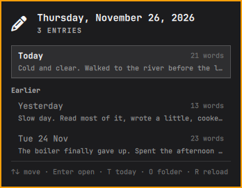

# Diary

A pencil in the Omarchy bar that opens today's diary entry. One click, one
blank page with today's date on it, written in [Omawrite](https://github.com/omacom/omawrite)
and saved as it is typed.



## Install

```bash
omarchy plugin add https://github.com/cosmicstasia/omarchy-diary --enable
```

That clones the plugin into `~/.config/omarchy/plugins/io.github.cosmicstasia.diary/`,
validates its manifest, and with `--enable` asks which bar section to put it in
(`left` is the default). Without `--enable`, add it later:

```bash
omarchy plugin enable io.github.cosmicstasia.diary --section left
```

Nothing is written outside the plugin folder until you click the pencil.

## Remove

```bash
omarchy plugin disable io.github.cosmicstasia.diary   # take it off the bar
omarchy plugin remove io.github.cosmicstasia.diary    # delete the checkout
```

Your entries are yours: the plugin never deletes or rewrites anything in
`~/Documents/Diary`, so removing it leaves the diary where it is.

Entries are plain Markdown files in `~/Documents/Diary/`, one per day:

```
~/Documents/Diary/
├── 2026-11-26.md
├── 2026-11-25.md
└── 2026-11-24.md
```

A new entry starts with its date as a heading:

```markdown
# Wednesday, 26 November 2026

Then whatever you have to say.
```

## Autosaving

This is the part worth knowing. Omawrite autosaves half a second after the last
keystroke, but only for a file it has already read content from — a file that
does not exist yet waits for an explicit save. So the widget **creates the
entry, with its heading, before it opens it**. That is what makes a diary you
never have to save, and it is covered by a test.

`bin/diary` also gives a zero-byte file content for the same reason: an empty
file left in the folder by something else would otherwise opt that day out of
autosaving.

## Use

| Gesture | What it does |
|---|---|
| Left click | Open today's entry, creating it first if it does not exist |
| Right click | Browse the last entries, with word counts and first lines |
| Middle click | Open the diary folder |

In the panel: `↑`/`↓` (or `j`/`k`) move, `Enter` opens the selected entry,
`T` writes today, `O` opens the folder, `R` re-reads the folder, `Esc` closes.
`Tab` moves to the next panel in the bar.

The pencil is dimmed until something has been written today, and the tooltip
carries the day's word count.

## Settings

Kept in the widget's entry in `~/.config/omarchy/shell.json`, so
`omarchy bar set` works on them:

```bash
omarchy bar set io.github.cosmicstasia.diary directory '~/Documents/Journal'
omarchy bar set io.github.cosmicstasia.diary editor omawrite
omarchy bar set io.github.cosmicstasia.diary header '## %1'
omarchy bar set io.github.cosmicstasia.diary recentCount 30
```

| Key | Default | Meaning |
|---|---|---|
| `directory` | `~/Documents/Diary` | Where entries live. `~` and relative paths resolve against `$HOME`. |
| `editor` | `auto` | `auto` uses Omawrite when it is installed and the Omarchy default editor otherwise; `omawrite` and `default` force one. |
| `header` | `# %1` | Heading of a new entry, with `%1` standing for the date. Empty for a blank page. Only affects entries created afterwards. |
| `recentCount` | `14` | How many past entries the panel lists (3–60). |

The default editor is the one `omarchy default editor` sets. Whatever it is,
that editor decides when to save — only Omawrite autosaves.

## From a keyboard, or a script

The widget answers IPC calls, so it can be bound and scripted:

```bash
omarchy-shell io.github.cosmicstasia.diary write              # open today's entry
omarchy-shell io.github.cosmicstasia.diary openDate 2026-11-01
omarchy-shell io.github.cosmicstasia.diary toggle             # the panel
omarchy-shell io.github.cosmicstasia.diary todayPath          # print today's path
foot -e nvim "$(omarchy-shell io.github.cosmicstasia.diary todayPath)"
```

A binding lives in `~/.config/hypr/bindings.lua`:

```lua
o.bind("SUPER + ALT + D", "Diary", "omarchy-shell io.github.cosmicstasia.diary write")
```

## Moving it in the bar

```bash
omarchy bar move io.github.cosmicstasia.diary --section right
```

## Dependencies

- [Omawrite](https://github.com/omacom/omawrite) — optional, and what makes the
  diary autosave. The plugin opens entries in whichever the `editor` setting
  resolves to: Omawrite when it is installed, the Omarchy default editor
  (`omarchy default editor`) otherwise.
- `bash`, GNU `find`/`awk`/`sed`, and `xdg-open`, all from the base system.

No network access, no daemon, no accounts, and no configuration files of its
own: the settings live in the bar's `shell.json`, and the entries are plain
Markdown.

## How it is put together

| File | What it is |
|---|---|
| `BarWidget.qml` | The bar button, tooltip, and the IPC target. |
| `Panel.qml` | The popup: today's row, the earlier entries, the keyboard cursor. |
| `DiaryStore.qml` | A singleton holding the settings, the processes, and the state. One instance for every monitor, so polling happens once. |
| `Diary.js` | Date arithmetic, folder rules, and the parsing of the script's output. Qt-free, unit tested under node. |
| `bin/diary` | The only thing that touches the disk: `path`, `folder`, `ensure`, `stats`, `list`. |
| `i18n/` | String catalogs, following the language picked in Omarchy's setup. |

### A private folder

The diary folder has to be one no other account can write to. The editor
opens an entry by its path after `bin/diary` has created and checked it, so
anyone who could rename files in the folder could swap the entry for a
symlink in between and have your writing saved somewhere else. `bin/diary`
therefore checks the folder and every directory on the way to it, symlink
targets included, before it reads or writes any entry. It refuses (and the
panel says so) when any of them is owned by another user, or writable by
group or others, including through a POSIX ACL. A sticky directory above the
folder, like `/tmp`, is fine. The folder itself never is.

The default `~/Documents/Diary` passes as it is. Folders the plugin creates
are `0700`. If you point it at a shared folder, fix it with:

```bash
chmod go-w ~/path/to/diary
```

Entries are created without ever opening a file at the entry's path: a
temporary file is filled in and then hard-linked into place, which fails
rather than following anything that appears there in the meantime.

Text from a file reaches the panel as untrusted input: excerpts are rendered
with `Text.PlainText`, capped in length, and folded to one line; a listing line
that does not carry a real date is dropped rather than repaired. Paths are
passed to processes as argument vectors, never assembled into a command.

## Editing it

The bar widget and `shell.json` hot-reload on save. The store is a singleton and
the panel's content stays loaded once it has been opened, so a change to
`DiaryStore.qml`, `Panel.qml`, or `Diary.js` only lands after

```bash
omarchy restart shell
```

`bin/diary` needs nothing: it is read fresh on every call.

## Tests

```bash
test/run-tests.sh
```

Runs against a temporary folder — it never reads or writes a real diary. It
covers the folder rules (in both implementations, which are compared against
each other), entry creation and non-destruction, the heading not being counted
as the writer's words, calendar validation, TSV safety of excerpts, listing
order and limits, the private-folder checks (permissions, ACLs, sticky
parents, symlinked folders), a symlink planted inside `ensure`'s race window,
and the JS helpers under node.

## License

MIT.
